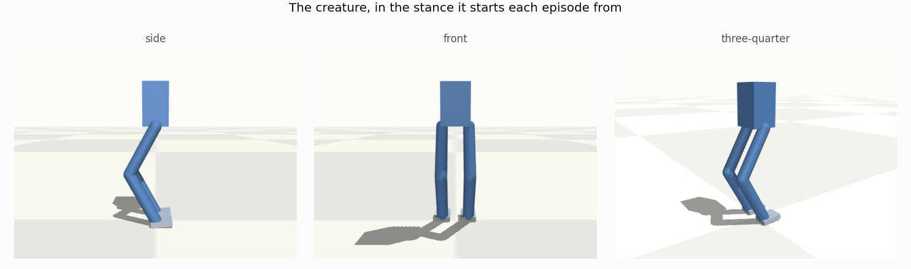
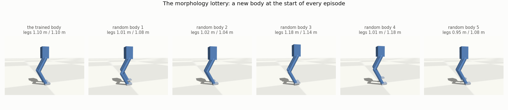
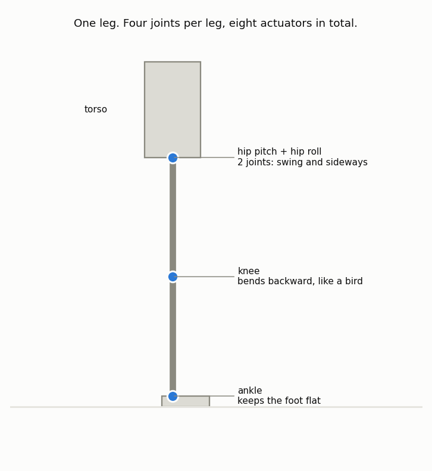
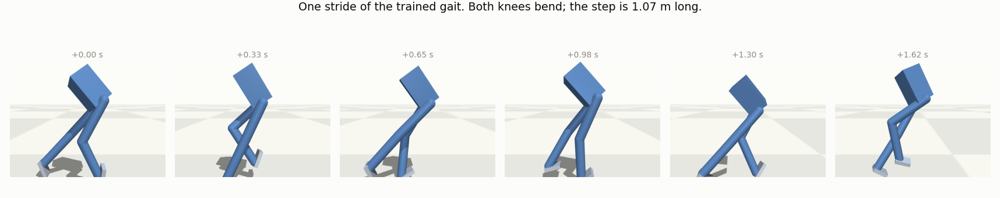
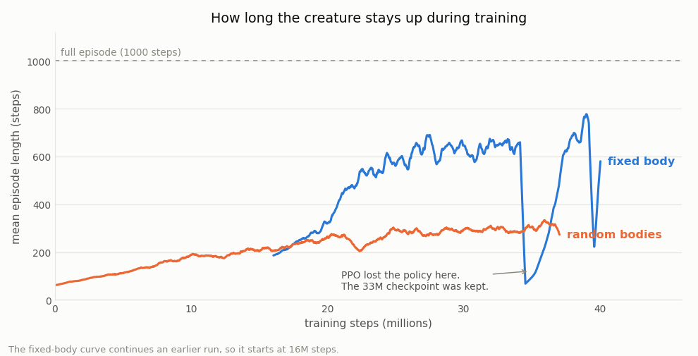
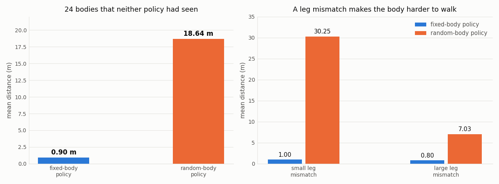

# RL Creature Walker

A reinforcement learning project. One policy learns to walk many different bodies.



## 1. Description

This project trains a policy to walk a two-leg creature in a physics simulation.

Most walk-learning projects use one fixed body. This project changes the body at the start of
each episode. The limb lengths, the torso size and the density change. The policy reads these
body values in its observation.



The policy must therefore adapt to its own body. It cannot learn one body only. The name of
this method is domain randomization. Robotics engineers use the same method to move policies
from simulation to real hardware.

The project has two parts:

- A fixed-body walker. This part makes one body walk well.
- A random-body walker. This part makes one policy walk many bodies.

## 2. The simulation

The physics engine is MuJoCo. The learning algorithm is PPO from Stable-Baselines3.

The creature has a torso and two legs. Each leg has four joints.



| joint | axis | function |
|---|---|---|
| hip pitch | lateral | swings the leg forward and backward |
| hip roll | forward | moves the leg sideways for lateral balance |
| knee | lateral | bends the lower leg |
| ankle | lateral | keeps the foot flat and gives push-off |

The knee bends backward. This is an avian knee, like the knee of an ostrich.

The creature has 8 actuators, one for each joint. The control rate is 40 Hz. The physics
timestep is 5 ms.

The observation has 36 values:

| values | content |
|---|---|
| 1 | torso height |
| 4 | torso orientation quaternion |
| 8 | joint angles |
| 6 | torso linear and angular speed |
| 8 | joint speeds |
| 2 | foot contact flags |
| 7 | body parameters |

The reward pays for forward speed, an upright torso, a correct height, a straight heading and
knee use. It also pays a small bonus for each step. The reward subtracts penalties for
sideways speed, sideways drift, control effort, rough control changes and flight.

An episode stops if the torso falls below 60 percent of the standing height. It also stops if
the torso tilts more than about 53 degrees. The step limit is 1000 steps, or 25 seconds.

`walker/mjcf.py` writes the MuJoCo XML for a body. `walker/env3d.py` holds the environment
and the reward.

## 3. The policies

The `models/` directory holds three policies.

| file | training | observation |
|---|---|---|
| `warmstart_morph36.zip` | one fixed body | 36 values |
| `LOTTERY_walk3d_morph_v2_35M.zip` | a new random body each episode | 36 values |
| `BEST_walk3d_bothknee_v5_33M.zip` | one fixed body (archived) | 35 values |

Use the first two policies. The third policy is older. It does not run with the present code,
because the observation changed from 35 values to 36 values.

### 3.1 Fixed-body policy

This policy walks one body. It uses 40 million training steps.



Results for 30 episodes:

| measurement | value |
|---|---|
| distance | 51 m per episode |
| speed | 2.04 m/s |
| stride length | 1.07 m per step |
| step rate | 1.9 steps per second |
| knee symmetry | 0.86 of 1.00 |
| falls | 1 episode in 30 |

A knee symmetry of 1.00 means that the creature uses both knees equally.

### 3.2 Random-body policy

This policy walks a new random body each episode. It uses 35 million training steps.

The episode length stopped at about 300 steps. The last 16 million steps did not make it
longer. But they did make the gait better. The distance on a new body went up by 3 times in
that period.



### 3.3 Comparison

Both policies walked the same 24 random bodies. Neither policy saw these bodies in training.



| policy | falls | mean distance | full episodes |
|---|---|---|---|
| fixed-body | 24 of 24 | 0.62 m | 0 |
| random-body | 17 of 24 | 21.33 m | 7 |

The fixed-body policy walks 51 m on its own body. It walks 0.62 m on a different body. The
random-body policy walks 34 times farther than the fixed-body policy on these bodies.

The fixed-body result changes between 0.6 m and 0.9 m from test to test. This policy falls
immediately on a new body. The small random start pose therefore has a large effect.

The leg mismatch changes the result. A leg mismatch is a difference between the length of the
left leg and the length of the right leg.

| bodies | fixed-body policy | random-body policy |
|---|---|---|
| small leg mismatch | 0.66 m | 31.39 m |
| large leg mismatch | 0.57 m | 11.26 m |

The random-body policy walks bodies with a small leg mismatch well. Bodies with a large leg
mismatch are still difficult.

## 4. How to run

### 4.1 Installation

```bash
pip install -r requirements.txt
```

MuJoCo 3.1.6 is necessary for Python 3.9. Later versions of MuJoCo have no Python 3.9 package.

### 4.2 Set the body

Make sure that `HIP_SEPARATION` is 0.28 in `walker/mjcf.py`. Both policies use this value.

A policy that runs on the wrong body falls down immediately. Check this value first if a
policy gives bad results.

### 4.3 Watch a policy

To watch the fixed-body policy:

```bash
python play.py --env-3d --model models/warmstart_morph36.zip --loop
```

To watch the random-body policy on a new body each episode:

```bash
python play.py --env-3d --model models/LOTTERY_walk3d_morph_v2_35M.zip --randomize --loop
```

The MuJoCo viewer opens. Drag with the mouse to turn the camera. Scroll to zoom. Close the
window to stop the program.

Do not hold the Ctrl key and drag on the creature. This applies a force and pushes the
creature over.

### 4.4 Measure a policy

To measure the gait of one policy:

```bash
python evaluate.py models/warmstart_morph36.zip --episodes 10
```

To compare the two policies on the same random bodies:

```bash
python morph_eval.py --bodies 24
```

### 4.5 Train a policy

To train on random bodies:

```bash
python train.py --name my_run --env-3d --randomize --timesteps 16000000 --n-envs 8
```

To train on one fixed body, remove `--randomize`. To continue from a saved policy, add
`--resume-from <file>`.

The program writes TensorBoard logs to `runs/`. To see the logs:

```bash
tensorboard --logdir runs
```

The program saves a checkpoint after each million steps. Keep these checkpoints. PPO
sometimes loses a good policy late in a run. The final file is then worse than an earlier
checkpoint. The training chart in section 3.2 shows one of these events.

### 4.6 Make the figures

To build the images in this file again:

```bash
python make_figures.py
```

## 5. Files

| file | function |
|---|---|
| `walker/mjcf.py` | writes the MuJoCo XML for a body |
| `walker/env3d.py` | the 3D environment and the reward |
| `train.py` | trains a policy with PPO |
| `play.py` | shows a policy in the MuJoCo viewer |
| `evaluate.py` | measures the gait of one policy |
| `morph_eval.py` | compares two policies on the same random bodies |
| `warmstart_morphology.py` | makes a policy accept a larger observation |
| `make_figures.py` | writes the images in `docs/img/` |
| `walker/env.py`, `walker/creature.py` | the earlier 2D version, with pymunk |

The 2D version works. It was the first version of this project. The 3D version replaced it,
because the two legs of a 2D creature move in the same plane. The legs pass through each
other during a step.

## 6. Paper

The paper gives the full method, the experiments and the results. It also explains the reward
design and the failures during development.

[Read the paper](docs/paper.md)

## 7. Limitations

- The random-body policy walks a full episode on 7 of 24 new bodies. It falls on the other 17.
- Bodies with a large leg mismatch are still difficult.
- The fixed-body policy falls in about 1 episode in 30.
- The body shape is constant. The creature always has two legs and eight joints. A creature
  with a different number of legs needs a different policy structure.
