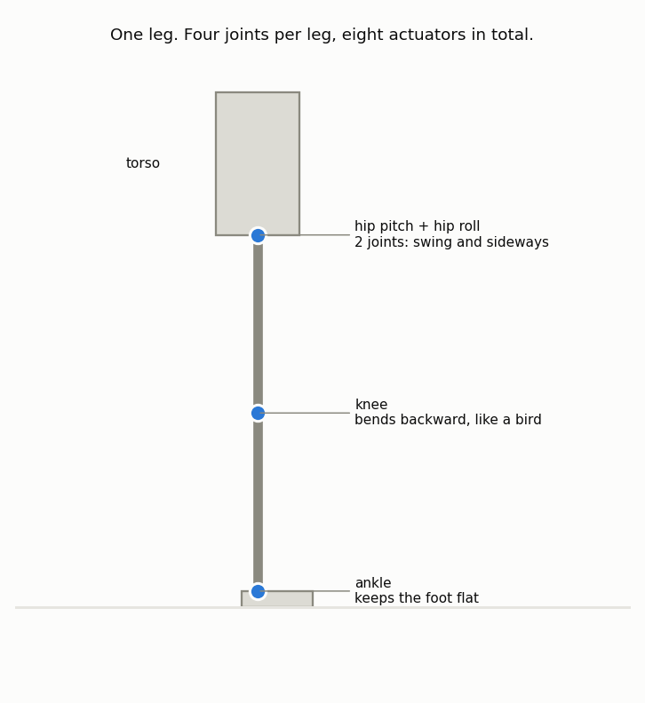
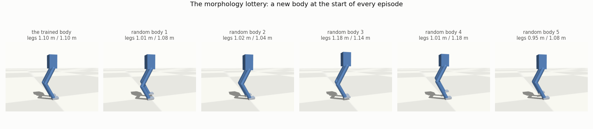
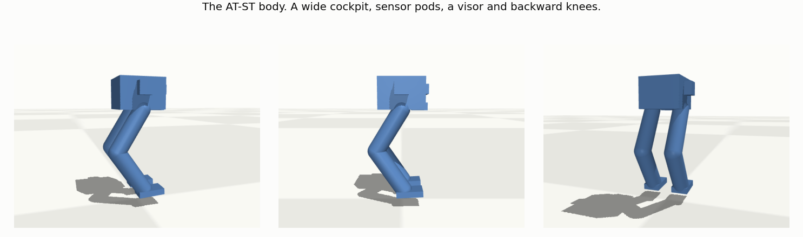
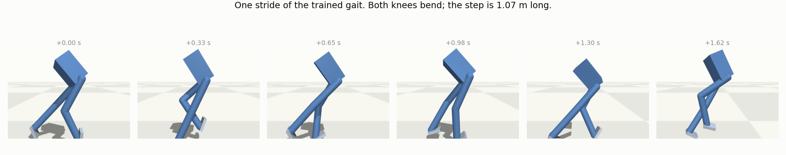
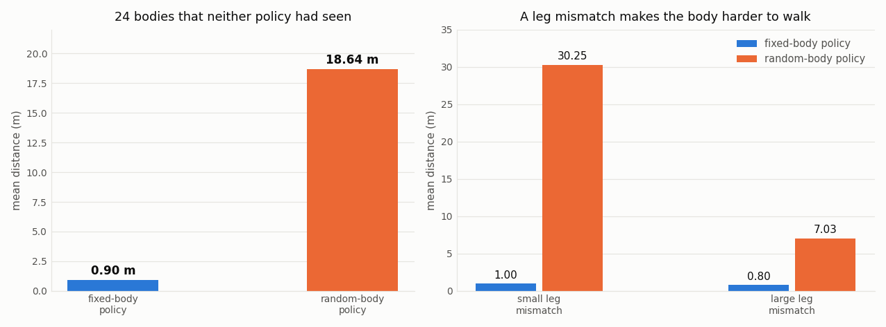
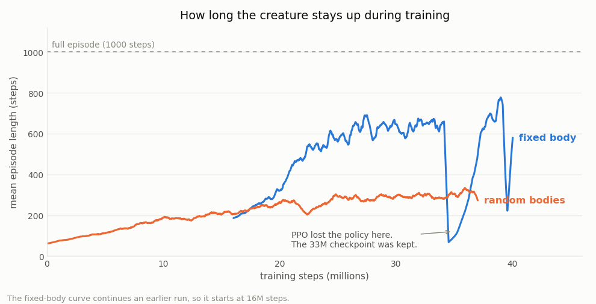

# One Policy for Many Bodies

A report on a reinforcement learning walker with a random body.

Sean Jackson, November 2026

---

## Summary

A policy that learns to walk one body does not walk a different body. This report
shows how large that effect is, and what removes it.

We trained two policies on the same simulated two-leg creature. The first policy
used one fixed body. The second policy used a new random body at the start of each
episode, and read the body values in its observation.

We then gave both policies the same 24 new bodies. The first policy fell on all 24
bodies and walked 0.62 m. The second policy walked 21.33 m and completed 7 episodes.
The second policy therefore walked 34 times farther.

The report also lists the failures during development. Most of the work was not the
learning algorithm. Most of the work was the reward function and the measurements.

## 1. Introduction

A common project in reinforcement learning is a creature that learns to walk. The
usual form of this project uses one body. The policy learns the dimensions of that
body during training. It does not need to measure its own body, because the body
never changes.

This report uses a different form. The body changes at the start of each episode.
The limb lengths, the torso size and the density change. The policy receives these
values in its observation. The policy must therefore read its own body and adapt.

Robotics engineers call this method domain randomization. They use it to move a
policy from a simulation to real hardware, because the real hardware is never an
exact copy of the simulation.

Two questions follow:

1. How much does a fixed-body policy lose on a new body?
2. Does a random-body policy keep its gait quality?

## 2. Method

### 2.1 The creature

The simulation uses the MuJoCo physics engine. A procedure writes the model file for
each body, so a new body needs no manual work.

The creature has a torso and two legs. Each leg has four joints: a hip pitch joint, a
hip roll joint, a knee joint and an ankle joint.

The hip pitch joint swings the leg forward and backward. The hip roll joint moves the
leg sideways. A two-dimensional creature does not need the roll joint, because it
cannot fall sideways. A three-dimensional creature can fall sideways, so this joint
is necessary.

The knee bends backward, like the knee of a bird. The ankle keeps the foot flat on
the ground and gives push-off.

The creature has 8 actuators, one for each joint. The control rate is 40 Hz.

### 2.2 The observation

The observation has 36 values:

| values | content |
|---|---|
| 1 | torso height |
| 4 | torso orientation quaternion |
| 8 | joint angles |
| 6 | torso linear and angular speed |
| 8 | joint speeds |
| 2 | foot contact flags |
| 7 | body parameters |

The last 7 values are the body parameters. They are the torso height, the torso
width, the density and the four limb lengths. The program scales each value to the
range -1 to +1. A value of 0 is the middle of the range.

The body parameters are always present, even for a fixed body. The observation size
is therefore constant, and one network shape serves both experiments.

### 2.3 The reward

The reward pays for forward speed, an upright torso, a correct torso height, a
straight heading and knee use. It also pays a small bonus for each step.

The reward subtracts penalties for sideways speed, sideways drift, control effort,
rough control changes and flight. Flight is the state where both feet are off the
ground.

An episode stops if the torso falls below 60 percent of the standing height. It also
stops if the torso tilts more than 53 degrees. The step limit is 1000 steps, or 25
seconds.

### 2.4 Training

The learning algorithm is PPO from the Stable-Baselines3 library. Eight copies of the
environment run in parallel.

The fixed-body policy used 40 million steps. The random-body policy used 35 million
steps.

### 2.5 The random bodies

The ranges are centred on the fixed body. The fixed body therefore scales to all
zeros, and sits in the middle of the distribution.

| parameter | fixed body | range |
|---|---|---|
| thigh length | 0.55 m | 0.45 to 0.65 m |
| shin length | 0.55 m | 0.45 to 0.65 m |
| torso height | 0.44 m | 0.36 to 0.52 m |
| torso width | 0.30 m | 0.24 to 0.36 m |
| density | 900 | 700 to 1100 |

Each leg is sampled on its own. The two legs of one creature are therefore often
different lengths. We call this difference the leg mismatch.

## 3. Development

The learning algorithm never changed during this project. The settings for PPO are
close to the library defaults. Almost all of the work was in the environment: the
body, the reward and the measurements.

This section lists the failures, because they carry more information than the final
result.

### 3.1 An impossible task

The first version of the creature was two-dimensional. Nine training runs gave the
same behaviour: the creature leaned forward and fell on its face. We changed the
survival bonus, the fall penalty, the exploration setting, the motor speed limit and
the stop conditions. The behaviour did not change.

The cause was not the reward. The task had no solution. The body had two faults:

1. **No feet.** Each leg ended in the thin bottom edge of a box. This gives about 2
   degrees of tilt margin.
2. **Weak motors.** Each limb weighed about 19 kg. A hip needs about 37 N m to hold
   one leg out. The motor gave 28 N m. The creature could not lift its own leg.

Feet, lighter limbs and stronger motors fixed the problem. The next run walked 18 m.

This is the most useful lesson in the project. A policy that gives the same wrong
behaviour across many reward settings is a signal. Check that the behaviour is
physically possible before you change the reward again.

### 3.2 The move to three dimensions

The two-dimensional creature walked, but both legs moved in the same plane. The legs
passed through each other during a step. This is not a collision fault. It is a limit
of a two-dimensional creature.

We therefore moved to MuJoCo and three dimensions.

### 3.3 Eight rewards, eight wrong gaits

Each new reward term fixed one wrong gait and showed the next one:

| the creature learned to | because the reward |
|---|---|
| fall forward again and again | paid for forward speed, and a fall is forward speed |
| stand still | paid a survival bonus that was larger than the gain from walking |
| walk on its knees | paid for lifted feet, and paid nothing for height |
| hop on one straight leg | paid for each lifted foot, so a hop with two feet paid twice |
| march in one place | paid for a lifted foot at zero speed |
| drag one straight leg | added the two knees together, so one knee collected half |
| take very short steps | paid for knee speed, and short fast steps give high knee speed |

The last two failures are the clearest. A measurement of the reward showed that
forward speed paid 4.23 of the 5.7 reward per step. A creature that locks one knee
keeps its speed. It therefore earned 0.58 more reward per step than a creature with
two working knees.

The policy was correct. The reward was wrong. More training steps cannot repair a
reward whose best answer is the wrong behaviour.

The repair was to pay for the **weaker** of the two knees, not for the sum. A locked
knee then pays nothing. Knee symmetry went from 0.09 to 0.86.

### 3.4 The AT-ST

The knee direction is a choice. A forward knee is a human knee. A backward knee is an
avian knee, like the knee of an ostrich. A two-leg machine with backward knees looks
like an AT-ST walker from Star Wars.

We built this body for one part of the project.

The body has a wide low cockpit, two sensor pods, a visor and a chin. The legs hang
from the flat underside.

This body walked well. It completed full episodes and walked 36 m. It also taught two
things.

First, the reward terms that force a human knee to bend are harmful to an avian knee.
An avian knee bends without help. The extra terms held it back, and the creature fell
after 1.5 seconds. A simpler reward fixed this.

Second, a picture is a cheap test. We rendered the model to an image file and looked
at it. The first version was a thin plate on two sticks, and did not look like an
AT-ST. The image showed this in one second. A description in the model file does not.

The project later replaced this body with a plain tall box, because a simple shape is
easier to study.

### 3.5 Measurements that gave the wrong answer

Four measurements were wrong at some point. Each one hid a fault that was clear on
the screen.

**Episode length is not gait quality.** Two runs almost reached the step limit. They
looked like the best runs in the project. The creature was squatting in one place.
Reward divided by step count was 2.31. The posture terms alone pay about 2.4. The
creature had never walked.

**Distance is not walking.** One policy walked 9.3 m per episode with steps of 0.22 m
at 4.6 steps per second. The distance looked correct. The step length showed the
fault.

**Range is not movement.** A measurement of the largest knee angle minus the smallest
knee angle reported 1.1 radians for a straight knee. The value came from the start
pose, not from the gait. Movement per step is the correct measurement.

**An average over a failed episode measures the failure.** Every episode ended in a
fall. The torso roll angle therefore measured the fall, not the gait. The measurement
became useful after we removed the last 25 steps of each episode.

In each case a person watched the creature and reported a fault. In each case the
measurement disagreed, and the person was correct.

### 3.6 Training faults

Three runs lost a good policy near the end. The episode length dropped from 646 steps
to 96 steps in one run, and did not recover. A checkpoint after each million steps
saved the work. The last file of a run is not always the best file of a run.

## 4. Results

### 4.1 The fixed-body policy

The fixed-body policy walks its own body well.

| measurement | value |
|---|---|
| distance | 51 m per episode |
| speed | 2.04 m/s |
| step length | 1.07 m |
| step rate | 1.9 steps per second |
| knee symmetry | 0.86 of 1.00 |
| falls | 1 episode in 30 |

### 4.2 The comparison

Both policies walked the same 24 random bodies. Neither policy saw these bodies
during training. The test used the same bodies for both policies, so the comparison
is paired.

| policy | falls | mean steps | mean distance | full episodes |
|---|---|---|---|---|
| fixed-body | 24 of 24 | 53 | 0.62 m | 0 |
| random-body | 17 of 24 | 428 | 21.33 m | 7 |

The fixed-body policy walks 51 m on its own body and 0.62 m on a new body. This is
not a weak policy. It is a policy that holds one gait only.

The leg mismatch changes the result:

| bodies | fixed-body policy | random-body policy |
|---|---|---|
| small leg mismatch | 0.66 m | 31.39 m |
| large leg mismatch | 0.57 m | 11.26 m |

A body with two equal legs is therefore much easier than a body with one long leg and
one short leg.

### 4.3 Training behaviour

The two curves show an effect that is easy to miss. The random-body curve stops at
about 300 steps after 21 million steps. The next 16 million steps did not make the
episodes longer.

But those steps did improve the gait. The distance on a new body went up by about
three times in the same period. Episode length and gait quality are therefore not the
same measurement. A flat episode-length curve is not proof that training is complete.

## 5. Limitations

- The random-body policy falls on 17 of 24 new bodies. It walks a full episode on 7.
- A large leg mismatch is still difficult. The policy walks 11.26 m on these bodies
  and 31.39 m on bodies with equal legs.
- The fixed-body policy falls in about 1 episode in 30.
- The ranges are narrow. Each parameter changes by about 18 percent. A wider range is
  the next test.
- The body shape is constant. The creature always has two legs and eight joints. A
  creature with a different number of legs needs a different network, because the
  observation size would change with the body.
- The test uses 24 bodies. A larger test would give a smaller error on the mean.

## 6. Conclusion

A policy trained on one body is fit for one body. On 24 new bodies it walked 0.62 m
and fell every time. A policy trained on random bodies walked 21.33 m on those same
bodies. The body parameters in the observation are what make this possible.

The learning algorithm was not the difficult part. The difficult parts were the
reward function and the measurements. A reward that pays for the wrong behaviour
gives the wrong behaviour, and the policy is correct to take it. A measurement that
agrees with a bad gait is worse than no measurement.

The most reliable test in this project was a person who watched the creature walk.
